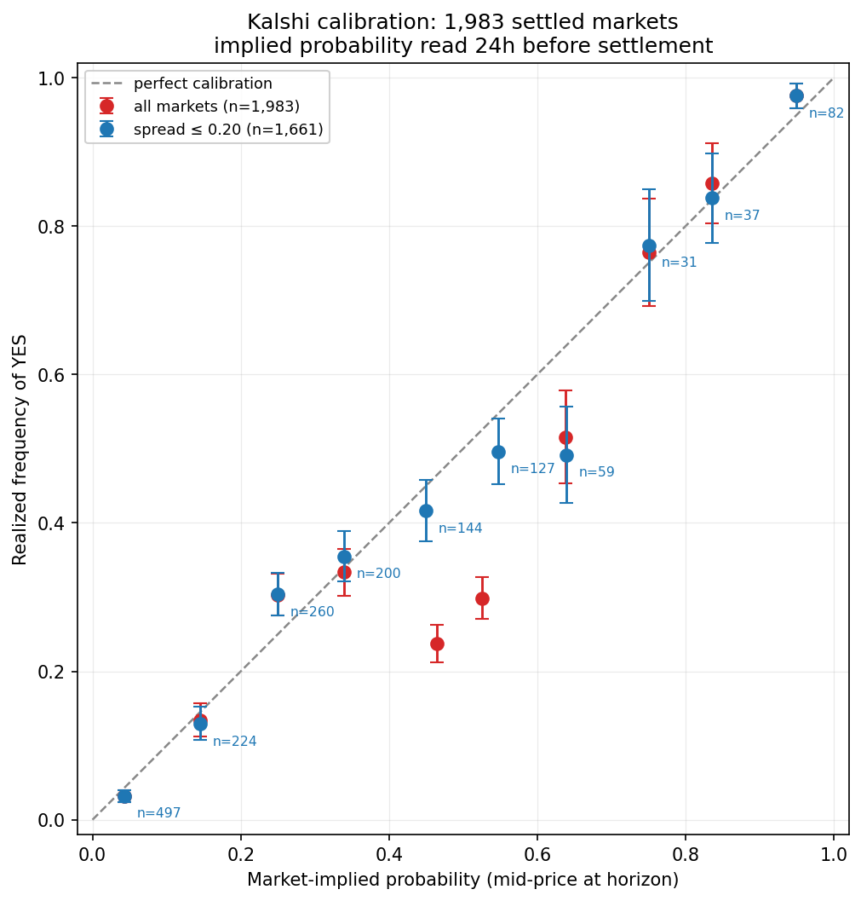
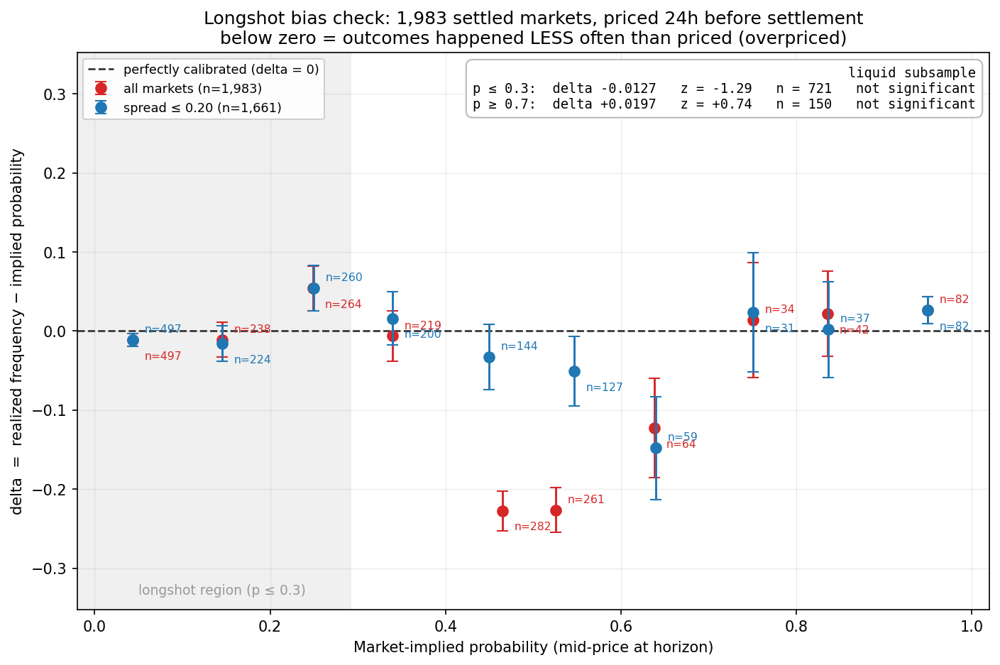
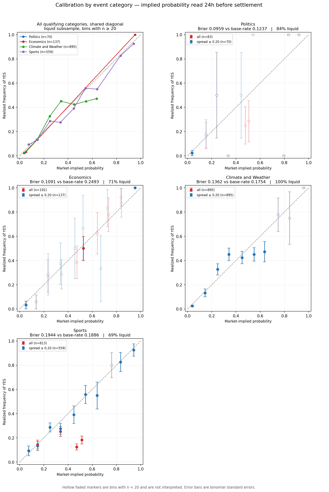
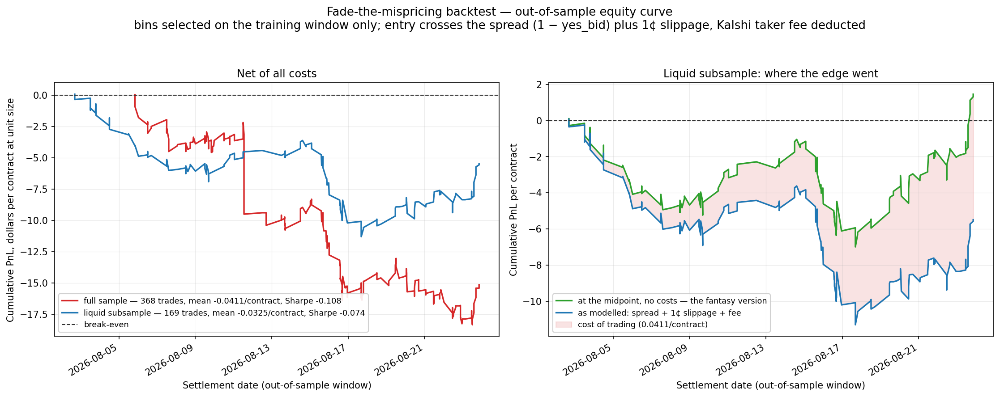

# Prediction Market Calibration & Backtesting Engine

**When a Kalshi market says 34%, does that thing actually happen about 34% of the time?**
This measures it across 1,983 settled markets, scores it with proper scoring rules, breaks it
down by event category, and tests whether the mispricing that shows up is tradeable after costs.

Python · asyncio · httpx · pandas · NumPy · SQLite · matplotlib

---

## Results at a glance

| | |
|---|---|
| Settled markets analysed | **1,983** (from 2,715 discovered) |
| Price history stored | **141,073** hourly candles |
| Brier score | **0.1558** vs 0.1937 base-rate baseline — **19.6%** better |
| Log loss | **0.4634** vs 0.5759 baseline |
| Longshot bias | **Measured, not found** — −0.0112 at p ≤ 0.3, z = −1.14 |
| Categories analysed | **4**, all above the 40-market threshold |
| Backtest, out-of-sample | 169 trades, Sharpe/trade **−0.074**, max drawdown **−11.37**/contract |

Kalshi prices in this sample are **well calibrated in aggregate**. No systematic
mispricing survives a significance test, and the naive strategy built to exploit
one loses money. Both are real findings and both are reported as measured.

---

## The data

**1,983 settled binary markets**, spanning **2026-06-17 to 2026-08-23** (67 days), across
**12 series** in **4 categories**:

| Category | Markets | Series |
|---|---|---|
| Climate and Weather | 895 | `KXHIGHCHI` (327), `KXHIGHMIA` (288), `KXHIGHNY` (280) |
| Sports | 813 | `KXARGNACBSPREAD` (356), `KXBRASILEIROBGAME` (237), `KXALLSVENSKANTOTAL` (220) |
| Economics | 192 | `KXUE` (102), `KXFEDTWEETS` (42), `KXTSAW` (37), `KXAAAGASM` (11) |
| Politics | 83 | `KXAPRPOTUSD` (51), `KXACTBLUETOP` (32) |

The series list was **pinned before any prices were fetched**, from a discovery survey that
ranked candidates on horizon viability rather than on results. This matters: choosing series
after seeing calibration numbers would let the sample be selected on the answer.

**Attrition.** 2,715 markets were discovered and 732 (27%) produced no usable quote at the
horizon — within the 20–40% the spec anticipated. Tallied by reason:

| Reason | Count |
|---|---|
| `quote_out_of_range` — bid or ask sat at exactly 0 or 1, so there was no two-sided market | 617 |
| `none_at_horizon` — the contract did not exist 24 hours before it settled | 115 |

**Crypto and financial markets are excluded**, despite being by far the largest categories on
the exchange (`KXBTCD` alone has 291,438 settled markets). They are hourly or 15-minute
contracts: they do not exist 24 hours before settling, and 0% of a sampled batch yielded a
usable quote at the horizon. Excluded on a measured structural fact, before any prices were
analysed.

### Why 24 hours

Contract prices converge mechanically toward 0 or 1 as settlement approaches, so a probability
read at close is trivially accurate and measures nothing. Fixing the observation at 24 hours
before settlement makes the forecast non-trivial. The horizon is a free parameter, stated
explicitly with every result, and the stored candle history supports re-running at other
horizons without touching the API.

---

## Method

**Ingest.** An async pipeline (`asyncio.Semaphore(8)`, exponential backoff with jitter on 429
and 5xx only) pulls settled markets per series, then fetches a week of hourly candlesticks for
each. Every candle row is persisted — that is what makes "price series" accurate rather than a
single snapshot. Requests are signed with RSA-PSS.

**The horizon observation.** For each market, take the **last candle at or before**
`settle_ts − 24h`. "At or before" keeps the observation at least the full horizon away from
settlement, never accidentally closer. The implied probability is the **mid**, `(bid + ask)/2`,
deliberately rather than the ask — using the ask would fold the bid-ask spread into the measured
probability and make the market look systematically overconfident when it was only being
quoted widely.

**Scoring.** Implied probabilities are binned into 10 equal-width bins. Equal-width rather than
quantile bins on purpose: quantile bins equalise the counts and hide how thin the tails are, and
the tails are exactly where longshot bias would live. Bins with fewer than 20 observations are
plotted but excluded from every interpretive claim.

**A sanity gate that can halt the build.** Before any analysis runs, the pipeline checks that
markets resolving YES were priced higher than those resolving NO. They were: mean 0.5210
(n = 521) versus 0.2548 (n = 1,462), a difference of 0.2662 at **z = 21.0**. If prices and
outcomes were misparsed or misaligned, every downstream number would be meaningless *while still
plotting beautifully*, so this gate stops the run rather than warning.

---

## Calibration



**Headline, full sample (n = 1,983):**

| Metric | Measured | Base-rate baseline | Skill |
|---|---|---|---|
| Brier score | **0.1558** | 0.1937 | **+0.196** |
| Log loss | **0.4634** | 0.5759 | — |

Base rate (YES) = 0.2627. The skill score says the market's probabilities are **19.6% better**
than a forecaster who ignores prices entirely and always predicts the base rate. A Brier score
means nothing in isolation, which is why the baseline is reported beside it everywhere.

### The mid-range dip is empty order books, not mispricing

The red curve sags hard between 0.4 and 0.6 — a delta of **−0.2275** and **−0.2266** in those
two bins. Taken at face value that reads as the market massively overpricing coin-flip events.

It is an artifact, and the cause is specific. **322 of 1,983 markets (16.2%) are quoted around
0.045 / 0.906**, a mean spread of **0.861**. Those are empty books: their midpoint lands near
0.5 arithmetically while carrying no information at all, because it is the average of two lonely
orders rather than a price anyone would trade at. The ingest already rejects a bid of 0 or an ask
of 1, which is not sufficient to catch this.

Splitting on spread — a threshold of 0.20, against a starkly bimodal distribution where 1,649
markets sit at or below 0.10 and a separate cluster of 322 averages 0.861:

| Sample | n | Mean spread | Brier | Baseline | Skill | Log loss |
|---|---|---|---|---|---|---|
| **Full sample** | 1,983 | 0.1613 | 0.1558 | 0.1937 | +0.196 | 0.4634 |
| Liquid (spread ≤ 0.20) | 1,661 | 0.0256 | 0.1416 | 0.2060 | **+0.313** | 0.4273 |
| Illiquid (spread > 0.20) | 322 | 0.8610 | 0.2289 | 0.1064 | **−1.150** | 0.6495 |

On markets with a genuine two-sided quote, calibration is substantially better than the headline.
On empty books, the "price" is worse than useless — a skill score of −1.150 means those midpoints
are materially worse than ignoring them and guessing the base rate.

**Disclosure:** the 0.20 threshold was chosen *after* seeing the full-sample results, on
inspection of the spread distribution. It is defensible only because the justification is
outcome-independent (an empty book is not a probability, regardless of how it resolved), both
samples are computed and reported everywhere, and it is a declared config value. The full sample
is the headline throughout precisely because it is the one nobody got to choose.

---

## Longshot bias: measured, and not found

Betting markets are widely documented to overprice unlikely outcomes — people like buying cheap
lottery tickets, so long shots trade above their true frequency. This project set out to
quantify that. It is the single most-expected finding in the whole exercise, and it is not here.



**How it was tested.** For each bin, `delta = realized − mean_pred`. A negative delta at low
predicted probability *is* longshot bias: outcomes happening less often than they were priced.
Each delta is tested against the null hypothesis that outcomes arrived at exactly the rate the
market priced, so the standard error comes from `mean_pred`, not from the realized rate. Bins
below n = 20 are excluded from every claim.

**The aggregate result, both samples:**

| Sample | Region | n | mean_pred | realized | delta | z | Significant at 5%? |
|---|---|---|---|---|---|---|---|
| Full | p ≤ 0.3 | 735 | 0.0765 | 0.0653 | **−0.0112** | −1.14 | No |
| Full | p ≥ 0.7 | 158 | 0.8764 | 0.8987 | +0.0224 | +0.85 | No |
| Liquid | p ≤ 0.3 | 721 | 0.0751 | 0.0624 | **−0.0127** | −1.29 | No |
| Liquid | p ≥ 0.7 | 150 | 0.8803 | 0.9000 | +0.0197 | +0.74 | No |

**Per category, liquid subsample, low-probability region:**

| Category | delta | z | Significant? |
|---|---|---|---|
| Climate and Weather | −0.0136 | −1.22 | No |
| Politics | −0.0154 | −0.55 | No |
| Economics | −0.0198 | −0.50 | No |
| Sports | −0.0025 | −0.09 | No |

**Not one delta reaches significance, in either sample or in any category.** Every |z| is below
1.6.

### Why this is a real null rather than an underpowered one

The obvious objection is that the test simply lacked the sample to find anything. It did not.
The published standard error on the low-probability aggregate is **0.0098**, so at the
conventional 5% bar (1.96 × 0.0098) this test would have detected a bias of about **1.9
percentage points**. The longshot effect reported in the racetrack and sports-betting literature
is considerably larger than that. An effect of the usual size would have shown up clearly here.

### What can honestly be said

The low-probability delta is **negative in all four categories** and in both samples, which is
the direction longshot bias predicts. Four out of four agreeing in sign is mildly suggestive.
But every magnitude is roughly one to two percentage points, each is individually inside the
noise, and the aggregate does not clear a test with the power to catch a 1.9-point effect.

The honest description is **directionally consistent, statistically absent** — reported as a
shape in the data, never as a finding. On this sample, at a 24-hour horizon, these markets do
not exhibit measurable longshot bias.

---

## Calibration by event category



All four categories cleared the 40-market threshold, so none was marked "insufficient sample."

| Category | n | Base rate | Brier | Baseline | **Skill** | Log loss | % liquid |
|---|---|---|---|---|---|---|---|
| Politics | 83 | 0.1446 | 0.0959 | 0.1237 | +0.224 | 0.3051 | 84% |
| Economics | 192 | 0.5260 | 0.1091 | 0.2493 | **+0.562** | 0.3434 | 71% |
| Climate and Weather | 895 | 0.2268 | 0.1362 | 0.1754 | +0.223 | 0.4059 | 100% |
| Sports | 813 | 0.2522 | 0.1944 | 0.1886 | **−0.031** | 0.5711 | 69% |

**The aggregate number was hiding real variation.** Skill ranges from −0.031 to +0.562 — a spread
of 0.593, roughly three times the aggregate value of +0.196.

Note that Brier and skill **rank the categories differently**. Politics has the best raw Brier
(0.0959) but only middling skill, because its base rate is 0.1446 and a forecaster who blindly
said "14.5%" every time would already score 0.1237. Economics has a worse raw Brier and by far
the best skill, because its base rate is 0.5260 and guessing is genuinely hard there. This is
why the baseline column is not optional.

### Sports scores worse than guessing — and one series explains it

A skill score of −0.031 means Sports prices are *less* accurate than ignoring them. That result
survives checking, and the cause is nameable.

| Category | Liquid n | Skill | Illiquid n | Skill |
|---|---|---|---|---|
| Politics | 70 | +0.419 | 13 | −0.761 |
| Economics | 137 | **+0.714** | 55 | +0.184 |
| Climate and Weather | 895 | +0.223 | **0** | — |
| Sports | 559 | +0.224 | 254 | **−5.193** |

On liquid markets Sports is **+0.224**, in line with Weather. All 254 illiquid Sports markets
come from a **single series**, `KXARGNACBSPREAD` — 254 of its 356 markets, quoted on average
bid 0.016 / ask 0.913 on contracts that resolve YES 3.9% of the time.

Seven of the twelve series have **zero** illiquid markets. The liquidity problem is not a
gradient across the exchange; it is a handful of specific series with no order book.

`KXARGNACBSPREAD` was **not** dropped. It was pinned before any prices were fetched, and removing
it after seeing that it hurts is exactly what that discipline exists to prevent.

---

## Backtest: fade the mispricing



**Strategy.** Split the sample by settlement time at the 0.6 quantile. On the **training window
only**, find bins where outcomes arrived materially less often than priced
(`realized < mean_pred − 0.03`, n ≥ 20). Then on the **test window only**, buy one NO contract in
every market priced into one of those bins, and hold to settlement.

**Execution is modelled adversely**, which is where most backtests flatter themselves:

1. **Cross the spread.** A NO contract costs `1 − yes_bid`, not `1 − yes_ask` and certainly not
   `1 − mid`. You pay what someone will actually deal at.
2. **Then take slippage** — a further 1¢ adverse, for latency and for the order's own effect on
   a thin book.
3. **Then pay the fee** — Kalshi's taker fee, `ceil(0.07 × contracts × P × (1−P))` to the next
   cent, rounded up.

**Results, out-of-sample:**

| | Full sample | Liquid subsample |
|---|---|---|
| Trades | 368 | 169 |
| Hit rate | 0.7908 | 0.6923 |
| Break-even hit rate required | 0.8319 | 0.7248 |
| Mean PnL per contract | **−0.0411** | **−0.0325** |
| Sharpe per trade | **−0.108** | **−0.074** |
| Max drawdown | **−18.37** | **−11.37** |

Both lose money. Nothing was retuned to change that: adjusting the threshold after seeing the
out-of-sample result would silently convert the test set into a training set.

### Where the edge went

The strategy wins 69% of its trades and still loses. Every trade is therefore scored twice —
once at the midpoint with no costs, and once as actually modelled — so the three cost terms
reconcile the two exactly:

| Dollars per contract | Full sample | Liquid subsample |
|---|---|---|
| Gross PnL at the mid | **+0.1989** | **+0.0086** |
| − spread cost | −0.2199 | −0.0174 |
| − slippage | −0.0072 | −0.0096 |
| − taker fee | −0.0130 | −0.0141 |
| **= net PnL** | **−0.0411** | **−0.0325** |
| t-statistic on the *gross* edge | **+9.03** (significant) | **+0.26** (not significant) |

**Two different stories, and the t-statistics separate them.**

*Full sample:* an apparent gross edge of +0.1989 per contract, statistically overwhelming at
t = +9.03 — and entirely fake. It is the empty-book artifact in trading form: the midpoint says
0.50, so fading it looks enormously profitable, but a NO contract on those books costs
`1 − 0.016 = 0.984`. The spread cost of −0.2199 erases the +0.1989 almost exactly, because they
are the same number seen from two sides. You would be risking $1.00 to win $0.00.

*Liquid subsample:* the gross edge is +0.0086 with **t = +0.26** — indistinguishable from zero.

So the conclusion is not the flattering "there was an edge and costs ate it." It is stronger and
less comfortable: **at a 24-hour horizon on liquid markets there was no exploitable mispricing to
begin with.** That is consistent with the rest of the project — no significant longshot bias was
found in any category, and a strategy cannot harvest a bias that is not there.

Sharpe is reported **per trade** and is never annualized; annualizing requires holding-period and
capital-deployment assumptions this project does not make. Drawdown is in **dollars per contract
at unit size**, because position sizing is out of scope and there is no bankroll to take a
percentage of.

---

## Limitations

**Small n in the tail bins.** The extremes carry the fewest observations — 34 markets in the
0.7–0.8 bin, 42 in 0.8–0.9. Bins below n = 20 are plotted but excluded from every claim, and the
high-probability region has enough power to detect only about a 5-point effect (1.96 × its
published standard error of 0.0262), against about 1.9 points at the low end.

**Twelve series is not "Kalshi."** The sampling frame is 12 series in 4 categories over one
67-day window. Nothing here generalizes to the exchange as a whole, and Crypto and Financials —
which hold the overwhelming majority of Kalshi's markets — are structurally excluded.

**Weather is 45% of the sample** and supplies 479 of the 721 low-probability observations. Any
aggregate statement about low-probability markets is substantially a statement about three
cities' daily temperature markets. Those are ~6 mutually exclusive buckets per day of which
exactly one resolves YES, so that sample sits at low probability **by construction**, not because
anything was mispriced. The per-category breakdown exists to separate that structural effect from
genuine mispricing.

**The mid-price is not an executable price.** Calibration is measured at the mid, which is the
right convention for measuring a probability but is not a price anyone can trade at. The backtest
prices entry at the crossed spread plus a slippage allowance — but that allowance is an
assumption, not a measurement.

**The slippage model is softer than advertised in places.** `apply_slippage` clamps entry at 0.99,
so on **104 of 368** full-sample trades less than the intended 1¢ was actually charged (mean
0.00717 against 0.01 intended). It never makes entry better than the quote, and those trades lost
heavily regardless, but the cost model is more generous than it claims on the worst books.

**The 0.07 taker multiplier is assumed** for every market. Kalshi charges different multipliers
for some categories. No maker/taker distinction is modelled — every trade is assumed to be a
taker crossing the spread.

**One horizon only.** Everything is measured at 24 hours. The stored candle history supports a
horizon sweep without re-ingesting, but that sweep was not run.

**The liquidity threshold was chosen after seeing results.** Disclosed above, and the full sample
is the headline everywhere for that reason.

**`--all` has not been run end to end.** `--analyze` is exercised on every run and produced every
number here; the ingest half was verified separately. A fresh `--all` would collect a different
set of settled markets and would not reproduce these exact figures.

---

## Running it

```bash
pip install -r requirements.txt

cp .env.example .env        # then fill in your Kalshi API key ID and private-key path

python run.py --ingest      # discover markets, fetch price series -> SQLite  (hits the API)
python run.py --analyze     # calibration, categories, backtest -> outputs/   (offline)
python run.py --all         # both
```

`--analyze` reads only from SQLite, needs no API access, and rewrites everything in `outputs/` in
a few seconds. Every tunable lives in the `CONFIG` block at the top of `run.py`, and the config
actually used is recorded inside `results.json` alongside the metrics it produced.

**Credentials.** `KALSHI_API_KEY_ID` and `KALSHI_API_KEY_PATH` are read from `.env`, which is
gitignored along with `*.pem`. The private key lives outside the repository entirely.

### Outputs

| File | Contents |
|---|---|
| `outputs/results.json` | Every metric, the config used, the run timestamp, and the counts. **The single source of truth — every number in this README comes from it.** |
| `outputs/calibration.png` | Reliability diagram, full sample and liquid subsample |
| `outputs/longshot_bias.png` | Deviation from priced probability, with the longshot region marked |
| `outputs/calibration_by_category.png` | Shared-diagonal overlay plus one panel per category |
| `outputs/equity_curve.png` | Out-of-sample equity curve and the cost decomposition |

`results.json` also carries an `acceptance` block evaluating the project's twelve acceptance
criteria against real output, including which resume claim each one backs.

---

## Repository layout

```
auth.py        RSA-PSS request signing
client.py      async HTTP wrapper: signing, retry with jitter, concurrency cap
ingest.py      discovery, price-series fetch, SQLite persistence, ingest gates
analyze.py     scoring rules, calibration, category breakdown, backtest, plots
run.py         CLI entry point, CONFIG, results.json, acceptance criteria
bookkeeping/   build log: progress, decisions, glossary, questions
```

`bookkeeping/DECISIONS.md` records every choice that could have gone another way, including the
ones that went against the spec and why.
